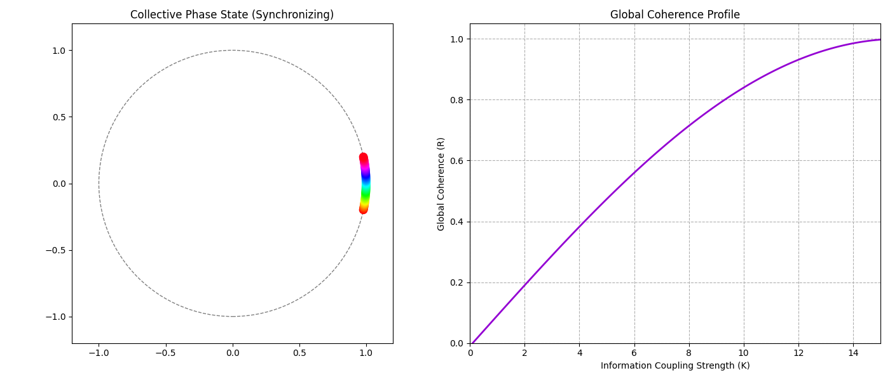

# Spectral Network Synchrony: Kuramoto Phase-Locking on Random Graphs

A Python simulation of how a network of independent, noisy oscillators falls into step as the coupling between them grows, analyzed with spectral graph theory.



## 1. Research Summary

The model combines two established tools:

- The **Kuramoto model** of coupled oscillators ([Kuramoto, 1984](#references)), which describes how units with different natural rhythms can synchronize.
- **Spectral graph theory**, which characterizes a network's structure through the eigenvalues of its Laplacian matrix ([Fiedler, 1973](#references)).

Together they show the transition from incoherence to global phase-locking as coupling strength increases. The same kind of transition is studied in several fields:

- **Cell communication:** coordinated electrical activity across groups of cells.
- **Neuroscience:** synchronization of neural populations, including proposed links to meditative and other altered states.
- **Distributed computing:** clock synchronization in decentralized systems.

The working question this project explores:

> **Hypothesis.** A network of uncoordinated, noisy nodes can reach functional unity purely through a coupling parameter, with no central controller, and the network's structure (its algebraic connectivity) shapes how readily that happens.

The current version demonstrates the transition on one network at a time. Testing how structure shapes it requires comparing many networks (see [Limitations](#5-limitations-and-next-steps)).

## 2. Mathematical Foundations

### A. Network Topology and the Graph Laplacian

The network is an unweighted, undirected [Erdős–Rényi random graph](https://en.wikipedia.org/wiki/Erd%C5%91s%E2%80%93R%C3%A9nyi_model) $G = (V, E)$. Its structure is captured by the **graph Laplacian**:

$$L = D - A$$

- $A$ is the **adjacency matrix**: $A_{ij} = 1$ if nodes $i$ and $j$ are connected, otherwise 0.
- $D$ is the diagonal **degree matrix**: $D_{ii} = \sum_j A_{ij}$, the number of connections of node $i$.

### B. Algebraic Connectivity (Fiedler Value)

The eigenvalues of $L$, sorted in ascending order, are:

$$\lambda_0 \le \lambda_1 \le \lambda_2 \le \dots \le \lambda_{n-1}$$

The smallest is always 0. The second smallest, the **Fiedler value**, measures **algebraic connectivity**. It is greater than zero if and only if the graph is connected, and larger values indicate a network that is harder to split apart and in which information spreads faster.

> **Note on indexing:** the code returns `eigenvalues[1]`, the second-smallest eigenvalue, labeled $\lambda_2$ in the plot (counting from 1).

### C. Kuramoto Coupling

Each node's phase evolves according to:

$$\frac{d\theta_i}{dt} = \omega_i + \frac{K}{N} \sum_{j=1}^{N} A_{ij} \sin(\theta_j - \theta_i)$$

- $\theta_i$: phase of node $i$
- $\omega_i$: natural frequency of node $i$, drawn from a normal distribution (mean 0, SD 0.5)
- $K$: global coupling strength
- $N$: number of nodes

Phases are integrated with Euler steps of $dt = 0.05$.

### D. Global Coherence (Order Parameter)

Synchronization is measured with the **Kuramoto order parameter** $R$:

$$R \cdot e^{i\psi} = \frac{1}{N} \sum_{j=1}^{N} e^{i\theta_j}$$

$R$ ranges from **0.0** (phases scattered, no coherence) to **1.0** (all nodes phase-locked).

## 3. Installation and Usage

Requires Python 3.9 or later.

```bash
pip install numpy scipy matplotlib
python collective_network_sim.py
```

The demo builds a 50-node network (connection probability 0.2) and runs 120 frames while increasing $K$ from 0.1 to 15.

**Output:** an animation with two panels:

- **Left:** each node's phase on the unit circle, with an arrow showing the collective phase and magnitude $R$.
- **Right:** $R$ plotted against coupling strength $K$.

## 4. Results

Three runs with random seeds 0–2, default settings:

| Seed | Fiedler value | R at start | R at end | K when R first exceeds 0.8 |
| --- | --- | --- | --- | --- |
| 0 | 2.43 | 0.04 | 0.87 | 14.5 |
| 1 | 2.59 | 0.05 | 0.87 | 14.0 |
| 2 | 3.20 | 0.19 | 0.89 | 12.9 |

In every run the network moves from near-total incoherence to strong phase-locking. The best-connected network (seed 2) crossed $R > 0.8$ at the lowest coupling strength, which is consistent with the hypothesis, though three runs are not enough to establish the relationship.

## 5. Limitations and Next Steps

- **Coupling and time increase together.** $K$ rises every frame, so the system never settles at a fixed $K$. Measuring $R$ after the system settles at each $K$ would give a cleaner transition curve.
- **Small sample.** Testing whether algebraic connectivity predicts the synchronization threshold needs many networks across a range of connection probabilities.
- **Performance.** The coupling loop is pure Python. A vectorized form using `A @ sin(...)` would allow larger networks.
- **Planned:** sweep connection probability, record the critical coupling $K_c$ for each network, and plot $K_c$ against the Fiedler value.

## References

- Kuramoto, Y. (1984). *Chemical Oscillations, Waves, and Turbulence*. Springer.
- Strogatz, S. H. (2000). From Kuramoto to Crawford: exploring the onset of synchronization in populations of coupled oscillators. *Physica D*, 143(1–4), 1–20.
- Fiedler, M. (1973). Algebraic connectivity of graphs. *Czechoslovak Mathematical Journal*, 23(2), 298–305.
- Arenas, A., Díaz-Guilera, A., Kurths, J., Moreno, Y., & Zhou, C. (2008). Synchronization in complex networks. *Physics Reports*, 469(3), 93–153.

## Related Projects

- [neural-criticality-eeg](https://github.com/abbykendrick/neural-criticality-eeg): fractal dimension and entropy across EEG state transitions.
- [bioelectric-morphogenetic-fields](https://github.com/abbykendrick/bioelectric-morphogenetic-fields): a bioelectric cellular automaton modeling tissue self-repair.

## Author

Abby Kendrick · [GitHub](https://github.com/abbykendrick) · [LinkedIn](https://www.linkedin.com/in/abbykendrick)
